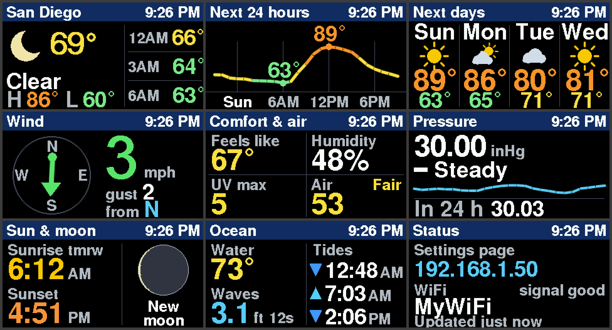
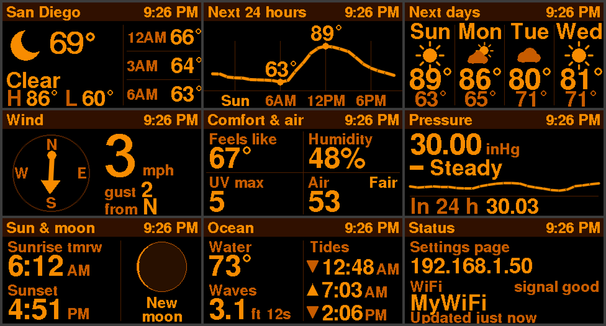
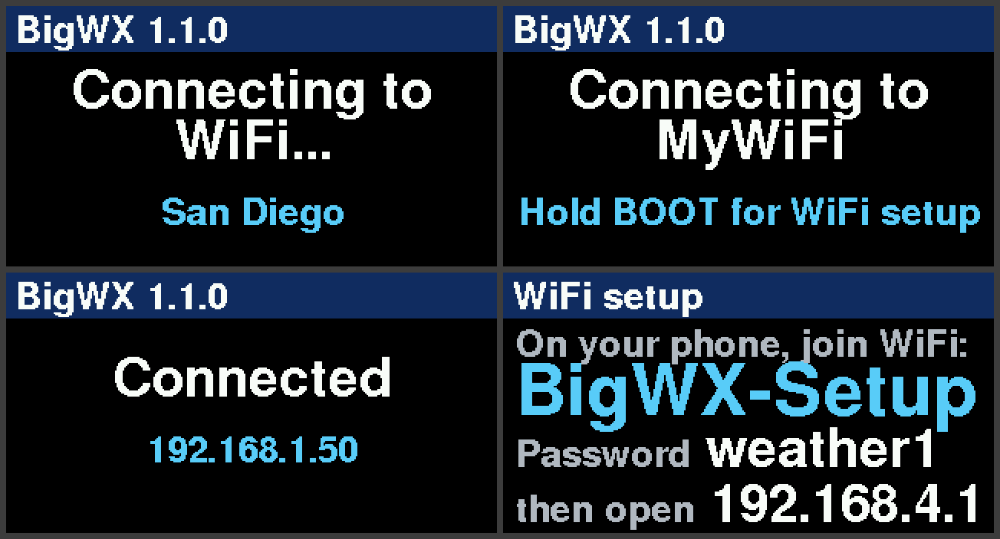
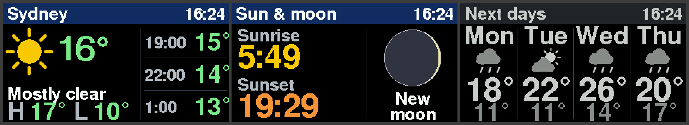
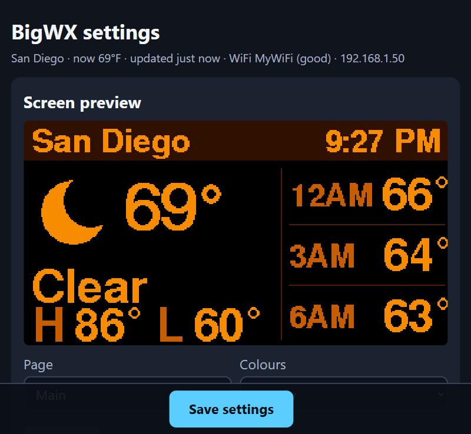

# BigWX — large-print weather display for the LilyGO T-Display S3

BigWX turns a LilyGO T-Display S3 (an ESP32-S3 board with a 1.9" 320 × 170 screen) into a weather display
that is easy to read from across the room. It was written for someone with low vision, so every value is big,
bold and high contrast, and at night the screen switches to a dim single-colour palette.

**No API keys, no accounts, no cloud service.** Weather comes from [Open-Meteo](https://open-meteo.com/) and
tides from Open-Meteo or [NOAA](https://tidesandcurrents.noaa.gov/), and it works anywhere in the world.



## Features

- **Nine pages**: current weather with the next hours, next 12–48 hours as a graph, next 3–4 days, wind, comfort and
  air quality, pressure trend, sun and moon, ocean (water temperature, waves, tides) and status.
  Turn pages on or off and change their order in the web settings.
- **Large print**: nothing on the screen is smaller than 12 pt bold, and the main values are 18 pt, 24 pt or 72 px digits.
- **Day and night colours**: in daylight, values are coloured by level (temperature, UV, air quality, wind).
  After sunset the screen switches to amber, red or grey on black at a lower brightness.
- **Works anywhere**: on first start it finds its location from the internet address and picks units for the country.
  Every unit can be changed: °C/°F, km/h / mph / m/s / knots, hPa / inHg / mmHg, metres/feet, 12/24-hour clock.
  The moon phase is drawn the right way round for the southern hemisphere.
- **Web settings page** with place search, a live screen preview, page options, a settings backup, and
  firmware updates over WiFi.
- **Easy WiFi setup** from a phone; hold a button to change the network later.

| Night colours | Start screens |
|---|---|
|  |  |



## What you need

- A [LilyGO T-Display S3](https://lilygo.cc/products/t-display-s3) with 16 MB flash and 8 MB PSRAM (the usual
  version). Tested on the non-touch board; the touch version has the same screen and should work too.
- A USB-C cable and a 2.4 GHz WiFi network.
- To build the firmware: [PlatformIO](https://platformio.org/) (VS Code extension or the `pio` command line tool).

## Install

```bash
git clone https://github.com/dieron/BigWX.git
cd BigWX
pio run -t upload
```

PlatformIO downloads the ESP32 toolchain and libraries the first time (a few minutes). If more than one serial
device is connected, add `--upload-port COM5` (Windows) or `--upload-port /dev/ttyACM0` (Linux/macOS).
If the upload does not start, hold **BOOT**, press **RST**, release **BOOT** and try again.

Later updates can be installed over WiFi: open the settings page, choose *Firmware update* and select
`.pio/build/t-display-s3/firmware.bin`.

## First start

1. The screen shows **WiFi setup**. On your phone, join the WiFi network **BigWX-Setup** (password **weather1**).
2. A setup page opens (or open **http://192.168.4.1**). Choose *Configure WiFi*, pick your network and enter its password.
   You can also enter a place name, latitude and longitude here. If you leave them empty, the display finds its
   location from your internet address (city level).
3. The display connects and shows the weather. Its address is shown for a moment and on the **Status** page.

## Buttons

| Button | Short press | Hold |
|---|---|---|
| **BOOT** | Next page | 3 seconds: WiFi setup (to join another network) |
| **KEY** | Previous page | 1 second: colours automatic → day → night |

After a minute without a button press, the display goes back to the first page (this can be changed).

## Settings page

Open the address shown on the Status page (for example `http://192.168.1.50/`) or **http://bigwx.local/**
in a browser on the same network.



Everything is explained in **[docs/SETTINGS.md](docs/SETTINGS.md)**: location, units, pages and their options,
ocean and tides, display, password, backup and firmware updates.

## Data sources and privacy

| What | Source | Key needed |
|---|---|---|
| Forecast, current weather, UV, sunrise/sunset | [Open-Meteo Forecast API](https://open-meteo.com/en/docs) | No |
| Air quality (US AQI) | [Open-Meteo Air Quality API](https://open-meteo.com/en/docs/air-quality-api) | No |
| Waves, water temperature, modelled tides | [Open-Meteo Marine API](https://open-meteo.com/en/docs/marine-weather-api) | No |
| Exact tides (US stations) | [NOAA CO-OPS](https://api.tidesandcurrents.noaa.gov/api/prod/) | No |
| Location guess on first start | [ipapi.co](https://ipapi.co/), fallback [ip-api.com](https://ip-api.com/) | No |
| Place search on the settings page | [Open-Meteo Geocoding API](https://open-meteo.com/en/docs/geocoding-api) (from your browser) | No |

The display sends only the coordinates you set (to Open-Meteo) and the tide station id (to NOAA).
Your internet address is used to guess the location **only while no location is set**. There is no
telemetry and no account. The settings page is plain HTTP on your local network; set a password in the
settings if other people use the same network.

Open-Meteo is free for non-commercial use (up to 10,000 calls a day; BigWX makes about 250). Its data is
licensed [CC BY 4.0](https://creativecommons.org/licenses/by/4.0/): *Weather data by Open-Meteo.com*.

## Credits

BigWX is an independent project. These projects and resources made it possible or inspired it:

- **[Volos Projects — tDisplayS3WeatherStation](https://github.com/VolosR/tDisplayS3WeatherStation)**: the
  T-Display S3 weather station that started the idea. BigWX does not use its code; the
  [video](https://www.youtube.com/watch?v=VntDY9Mg7T0) is well worth watching.
- **[DL2MF — OpenWXStation](https://github.com/DL2MF/OpenWXStation)**: another T-Display S3 weather station
  (part of the OpenWX suite) whose description inspired the multi-page layout and the web settings page.
- **[TFT_eSPI](https://github.com/Bodmer/TFT_eSPI)** by Bodmer: display driver, including the GNU FreeFont
  (FreeSansBold) fonts and the large digit fonts.
- **[WiFiManager](https://github.com/tzapu/WiFiManager)** by tzapu: WiFi setup portal.
- **[ArduinoJson](https://arduinojson.org/)** by Benoît Blanchon.
- **[Arduino core for ESP32](https://github.com/espressif/arduino-esp32)** by Espressif, and [PlatformIO](https://platformio.org/).
- **[Open-Meteo](https://open-meteo.com/)** (CC BY 4.0) and **[NOAA CO-OPS](https://tidesandcurrents.noaa.gov/)** for the data.
- Date arithmetic: Howard Hinnant's [`days_from_civil`](https://howardhinnant.github.io/date_algorithms.html) algorithm.

## More

- [docs/SETTINGS.md](docs/SETTINGS.md): every setting, the web API and the backup file format
- [docs/DEVELOPMENT.md](docs/DEVELOPMENT.md): how the code is organised, adding a page, taking screenshots
- [CHANGELOG.md](CHANGELOG.md)

## License

[MIT](LICENSE). The libraries and fonts keep their own licenses.
